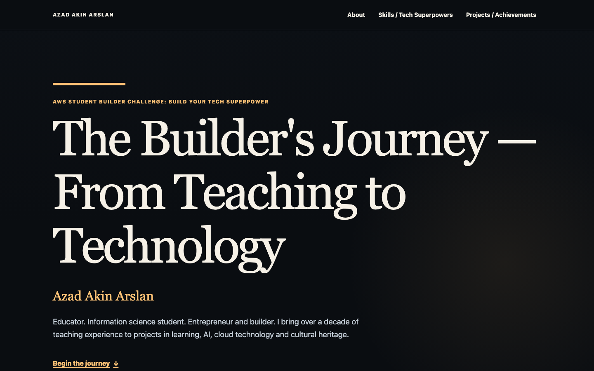
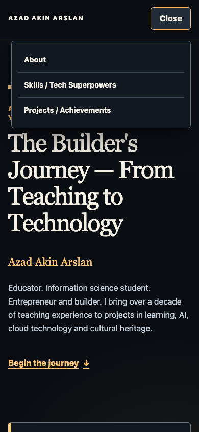
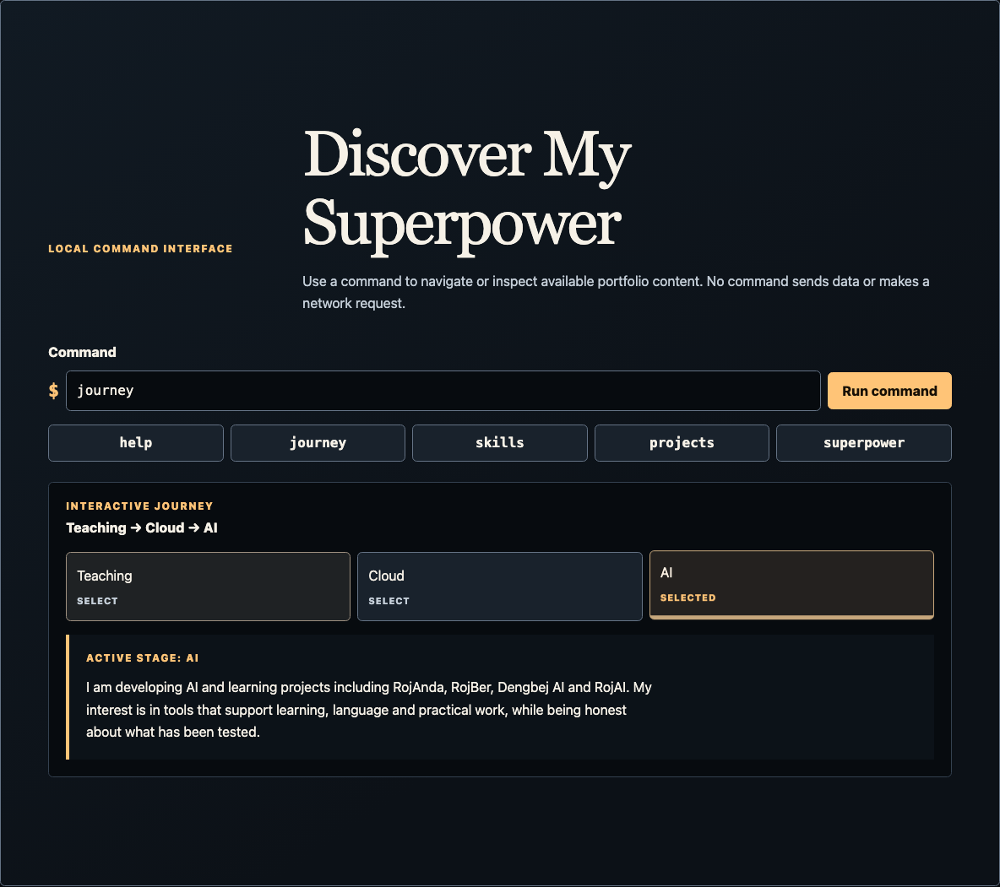
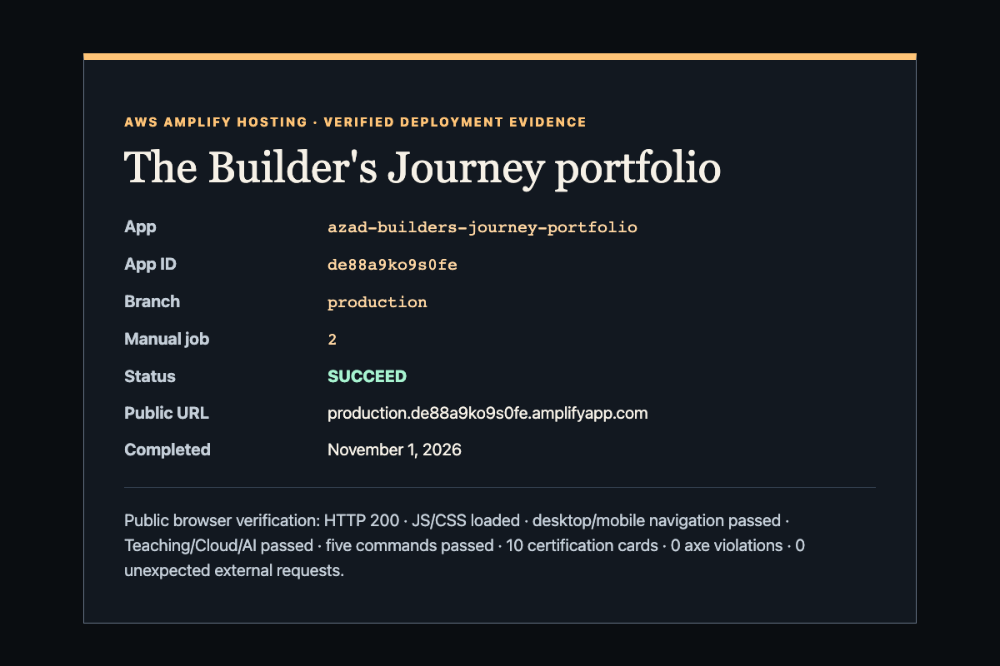

# Challenge submission draft

> **Owner review required before submission.** This is a draft only. No challenge entry has been submitted.

## Project title

The Builder's Journey — From Teaching to Technology

## Live project

- **Live portfolio:** https://production.de88a9ko9s0fe.amplifyapp.com/
- **Source repository:** https://github.com/arslakin/builders-journey-portfolio

## Short description

An accessible, interactive portfolio that connects more than a decade of teaching experience with current work in information science, cloud engineering, AI-assisted learning, entrepreneurship, and cultural heritage projects.

## What I built

The portfolio is a client-side React and TypeScript application with a dark editorial design. It presents a sourced About narrative, categorized technical and teaching skills, an interactive Teaching → Cloud → AI journey, six honestly labeled development-stage projects, and a certification collection that distinguishes issuer evidence from resume-reported or verification-pending status.

Visitors can use conventional desktop or mobile navigation or explore through a local command interface. The commands `help`, `journey`, `skills`, `projects`, and `superpower` run entirely in the browser. Unverified project destinations remain visibly non-operable instead of pointing to invented links.

## AWS implementation

AWS Amplify Hosting serves the Vite static build from a dedicated production app and branch:

- Amplify app: `azad-builders-journey-portfolio`
- App ID: `de88a9ko9s0fe`
- Branch: `production`
- Current manual deployment job: `2` (`SUCCEED`)
- Static output: `dist/`
- Auto-build and pull-request previews: disabled
- Backend, database, custom domain, and runtime AWS credentials: none

The final deployment was uploaded manually so publication did not require a Git operation or a connected repository. A same-origin browser check confirmed HTTP 200, successful JavaScript and CSS loading, and no unexpected external application requests.

## Accessibility and responsive behavior

The application includes semantic landmarks and heading order, visible keyboard focus, a skip link, touch-sized controls, mobile navigation with Escape and focus restoration, polite live command results, persistent non-motion journey selection, and reduced-motion behavior.

Automated evidence for the deployed version:

- 62 unit and component tests passed.
- 7 production-browser behavior tests passed.
- 2 automated axe suites passed with zero reported violations.
- Layout checks passed at 320, 375, 640, 767, 768, 1024, 1280, and 1920 CSS pixels without horizontal page overflow.
- Public desktop and mobile axe scans reported zero violations.

Automated checks do not replace manual screen-reader, contrast-tool, orientation, and actual 200% zoom review.

## Content integrity

Portfolio content is maintained in typed modules under `src/content/`. Every public factual field records owner-approved provenance. Certification cards use issuer documents where available and explicitly label uncertainty:

- CKA is shown as expired on December 3, 2025.
- Terraform Associate is shown as earned, with current validity unverified.
- AWS Solutions Architect – Associate and several other credentials remain resume-reported with issuer verification pending.
- The Udacity AWS AI Practitioner Challenge is identified as course completion, not the AWS Certified AI Practitioner certification.

Raw résumés, certificate PDFs, private credential identifiers, personal contact data, local paths, generated builds, test artifacts, and credentials are excluded from the repository.

## Personal learning reflection

> **OWNER TO WRITE OR REVISE BEFORE SUBMISSION.** Suggested prompts:
>
> - What did moving from teaching into technology change about how you design for learners and users?
> - What did you learn while connecting verified content, accessibility, local interactions, and static AWS hosting?
> - Which part of the command explorer, journey, content-verification boundary, or deployment process was most challenging?
> - How did working with Kiro affect your development and review process?
> - What would you improve or expand after the challenge?

## Screenshots

### Desktop portfolio

### Mobile navigation

### Interactive command and journey experience

### Verified Amplify deployment evidence

## Final review checklist

- [ ] Owner reviews all public biography and project wording.
- [ ] Owner writes or approves the personal learning reflection.
- [ ] Owner completes manual screen-reader, contrast, orientation, and 200% zoom checks or records any remaining limitation.
- [ ] Live URL and repository URL open without authentication.
- [ ] Challenge form fields and screenshot limits are checked against the current challenge portal.
- [ ] Owner explicitly submits the challenge entry.
